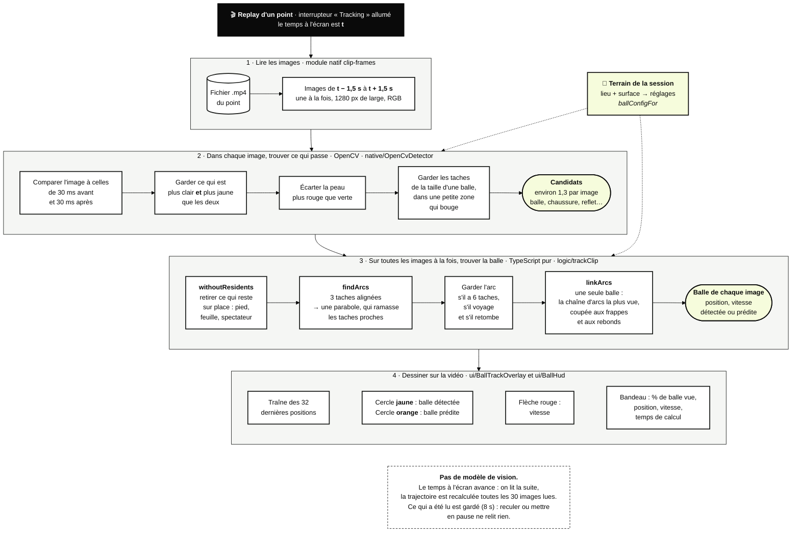

# Suivi de balle

Comment l'app trouve la balle dans le replay d'un point, en **v0.5**, sans modèle de vision : OpenCV pour les pixels, de la géométrie en TypeScript pour le reste. Le suivi ne tourne que sur le point affiché, quand l'interrupteur « Tracking » du replay est allumé ; jamais pendant qu'on filme. Il montre une trajectoire, jamais un dedans / dehors. Les réglages et leurs mesures sont dans [`CLAUDE.md`](../CLAUDE.md#balle-suivie-v05).

Image pour les slides : [`images/tracking.png`](images/tracking.png) (`npm run docs:images -- tracking` la regénère depuis ce fichier).

## Les quatre étapes

**1 · Lire les images.** `ReplayBallTracker` suit le temps à l'écran et demande au module natif `modules/clip-frames` les images du fichier, de 1,5 s avant à 1,5 s après. Un replay est un fichier : la suite d'une image est connue autant que ce qui la précède, et le suivi s'en sert. Les images sont lues en 1280 px de large, parce qu'une balle au fond du court ne fait que 2 à 10 px.

**2 · Trouver ce qui passe.** Une image seule ne suffit pas : la balle fait quelques pixels parmi les gradins, les vêtements et les ombres. Ce qui la distingue, c'est qu'elle passe. À sa place, l'image est plus claire et plus jaune qu'un instant avant **et** qu'un instant après. Une ombre qui arrive est plus sombre, un maillot est encore là l'image d'après, un bras est plus rouge que vert. Il n'y a pas de seuil de couleur absolu : à 2 px, la couleur de la balle se mélange à celle du fond. Le détecteur répond donc avec 1 ou 2 images de retard, le temps de connaître l'image d'après.

**3 · Trouver la balle parmi les candidats.** Le détecteur laisse passer d'autres taches que la balle. Ce qui distingue la balle, cette fois, c'est sa trajectoire : en vol, elle suit une parabole, image après image (tracker de Yan, Christmas et Kittler, BMVC 2005).

- `withoutResidents` retire d'abord ce qui habite au même endroit. La caméra ne bouge pas pendant un point, la balle ne fait que passer.
- `findArcs` part de trois taches proches dans le temps et à peu près alignées, ajuste une parabole, y ajoute les taches proches et recommence. Un rebond ou une frappe casse la parabole : l'arc s'arrête là.
- Un arc est gardé s'il passe par 6 taches au moins, s'il voyage (une tache qui scintille ne voyage pas) et s'il se courbe vers le bas (une balle retombe, une chaussure qui glisse va tout droit).
- `linkArcs` enchaîne les arcs : il n'y a qu'une balle, donc une seule chaîne, celle qui est vue sur le plus d'images. Deux arcs qui se croisent sont coupés au croisement : c'est la frappe ou le rebond.

Sur chaque image, la balle est « détectée » (une tache est sur l'arc) ou « prédite » (pas de tache, l'arc passe quand même par là).

**4 · Dessiner.** Le calque est posé sur la vidéo et zoome avec elle. Le bandeau donne les chiffres de l'image à l'écran.

## Où c'est dans le code

Tout est dans `src/features/ball-tracking/`.

| Fichier | Rôle |
|---|---|
| `useBallTrack.ts` | Le hook du replay : construit le suivi avec les réglages du terrain |
| `ReplayBallTracker.ts` | Le chef d'orchestre : suit le temps à l'écran, lit, détecte, recalcule, publie |
| `native/ClipFrames.ts` | Les images d'un fichier (module natif `modules/clip-frames`) |
| `native/OpenCvDetector.ts` | Étape 2, le seul fichier qui touche à OpenCV |
| `logic/trackClip.ts` | Étape 3 : `withoutResidents` → `findArcs` → `linkArcs` |
| `logic/ballConfig.ts`, `logic/ballConfigFor.ts` | Les réglages, et ce qu'un terrain y change |
| `ui/BallTrackOverlay.tsx`, `ui/BallHud.tsx` | Étape 4 : le calque et le bandeau |

Tout tourne sur le téléphone. `logic/` est du TypeScript pur : il ne dépend ni de React ni d'OpenCV.

## Quand le dessin ne colle pas à la balle

Mettre en pause et avancer image par image, puis regarder le bandeau.

| Ce qu'on voit | Ce que ça veut dire |
|---|---|
| En pause, pas de cercle, bandeau `ÉTAT PERDUE` | La balle n'a pas été trouvée sur cette image : détection ou suivi, pas l'affichage |
| En pause, le cercle est sur autre chose (un pied, une raquette) | Un mauvais arc a été gardé : suivi |
| En pause c'est juste, en lecture le cercle est en retard ou disparaît | L'analyse va moins vite que la lecture : regarder « ms / image » et « trajectoire » dans le bandeau. Avec plus de 0,5 s de retard, elle repart 0,2 s avant le temps à l'écran |
| En pause, le cercle est toujours à côté de la balle, du même côté | Le calque est mal posé sur la vidéo (rotation du fichier, caméra avant) |

## Limites connues

- La balle contre un joueur, au moment de la frappe, n'est pas détectée ; le suivi fait le pont entre les deux vols.
- Une balle devant le ciel ou un mur clair n'est pas « plus claire qu'avant et après » : elle disparaît.
- Les réglages sont mesurés sur une seule vidéo (dur, extérieur, 30 images par seconde). Les autres terrains gardent ces réglages tant qu'ils n'ont pas été mesurés.
- Le mode « Balle live » (dev seulement) utilise encore l'ancien suivi image par image (filtre de Kalman) : il sert à régler la détection sur le court, pas à suivre.
